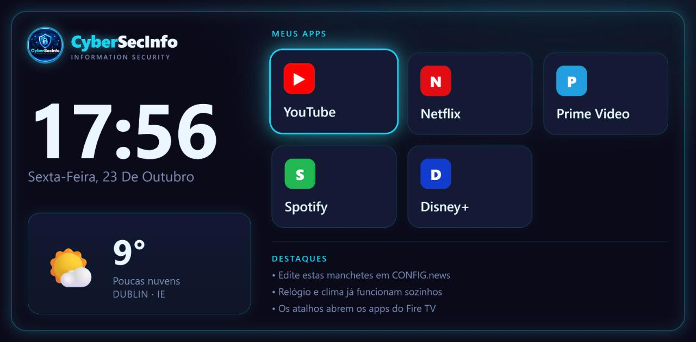

# CyberSecInfo TV

A lightweight **smart-TV home screen** — a neon launcher with a live clock, real-time weather, and app shortcuts you can drive with a TV remote. Built as a single static HTML file, it runs on any browser and is designed to be set as the boot screen of a **Fire TV Stick** (or any kiosk device wired to a TV).

> It's the same idea as the "custom TV system" videos going around — but it's just a web page. No native app, no SDK, no build step.

**Live demo:** [cybersecinfo.com/tv](https://cybersecinfo.com/tv/)



---

## Features

- 🕐 **Live clock & date** (pt-BR locale, 12/24h configurable)
- 🌤️ **Real-time weather** for any city — via the free [Open-Meteo](https://open-meteo.com/) API, no API key required
- 📺 **App shortcuts** (YouTube, Netflix, Prime Video, Spotify, Disney+)
- 🎮 **Remote-friendly navigation** — the D-pad arrow keys move focus between tiles, OK opens
- 🚀 **Native app launching on Fire TV** via [Fully Kiosk Browser](https://www.fully-kiosk.com/) (`fully.startApplication()`), with a web-URL fallback in normal browsers
- 🎨 **Neon CyberSecInfo identity** — themed, responsive, works on any screen size
- 📄 **Single file, zero dependencies** — no framework, no build

## How it works

The whole launcher is one `index.html`. There is no server-side code.

| Piece | How |
|-------|-----|
| Clock / date | Plain JavaScript `Date`, updated every second |
| Weather | Two `fetch` calls to Open-Meteo (geocoding + current forecast), mapped from WMO weather codes to icons |
| App tiles | `<a>` elements built from a `CONFIG` array; a click calls `fully.startApplication(pkg)` when running inside Fully Kiosk, otherwise follows the web `url` |
| Remote control | A `keydown` handler maps arrow keys to focus movement across the tile grid |
| Theming | CSS custom properties (navy `#0a0a1a` + cyan `#22d3ee`) |

> **Note:** Weather needs an internet connection and only works when the file is opened directly in a browser — a sandboxed preview blocks external requests.

## Run locally

Just open `index.html` in a browser, or serve the folder:

```bash
python -m http.server 8080
# then visit http://localhost:8080
```

## Run it on a TV (Fire TV Stick)

1. On the Fire TV: **Settings → My Fire TV → Developer options** → enable **Install apps from unknown sources**.
2. Install **Fully Kiosk Browser** (from the Amazon Appstore, or sideload with the **Downloader** app).
3. In Fully Kiosk → Settings:
   - **Start URL** → your hosted copy (e.g. `https://cybersecinfo.com/tv/`)
   - Enable **Start on Boot** and **fullscreen / kiosk mode**
4. Turn on the TV, switch to the Fire TV input → your home screen is there. Press **Home** to exit.

> Launching native apps on boot requires the one-time Fully Kiosk Plus unlock.

## Configuration

Everything is in one `CONFIG` object at the top of the `<script>` in `index.html`:

```js
const CONFIG = {
  city: "Dublin",      // weather city
  clock24h: true,      // false = 12-hour clock
  apps: [
    { name:"YouTube", tag:"▶", color:"#ff0000",
      pkg:"com.amazon.firetv.youtube", url:"https://www.youtube.com/tv" },
    // ...
  ],
  news: [ "..." ]      // headline strings
};
```

- `pkg` = the Fire TV app package name (opens the real app via Fully Kiosk).
- `url` = fallback opened in a normal browser.

## Tech

Vanilla HTML / CSS / JavaScript · Open-Meteo API · Fully Kiosk Browser (Fire TV) · no build tooling.

## License

[MIT](LICENSE) © 2026 Adriano Huttener
